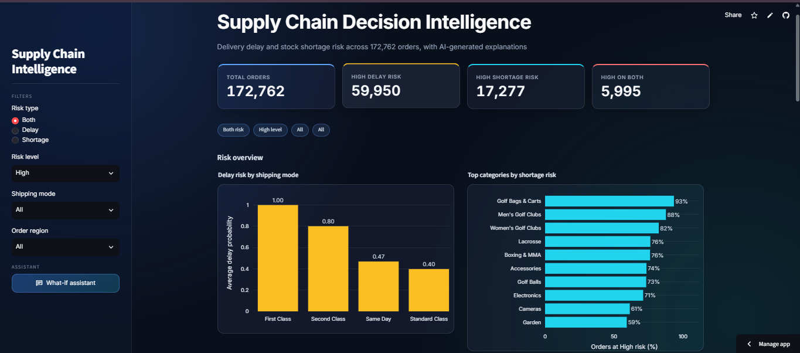
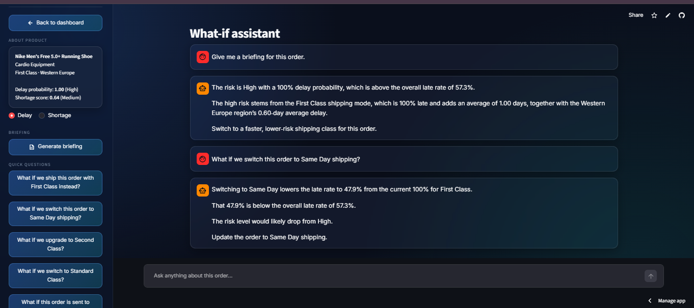
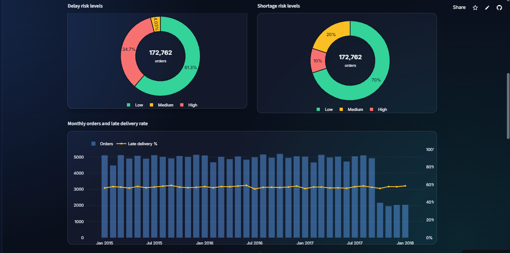
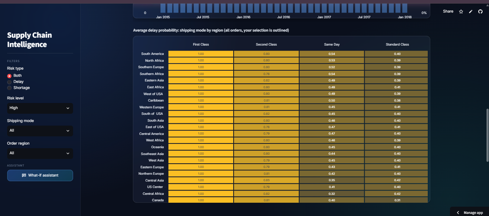
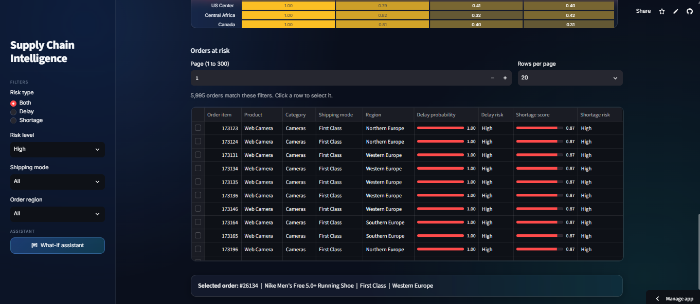

# Supply Chain Decision Intelligence

I built this project to answer one question: which orders are likely to arrive late or run into a stock shortage, and why? It predicts both risks, stores the results in a database, and shows them in a dashboard. A small AI assistant explains each risky order in plain words.

- **Live demo:** https://supply-chain-intelligence-abhrwr8dhtj3xs6ifxz9ud.streamlit.app/
- **API docs:** https://supply-chain-api-78md.onrender.com/docs

> The demo runs on free hosting. If nobody has opened it for a while, the first load can take up to a minute.



## What it does
- Predicts **delay risk** (probability that an order is delivered late) and **shortage risk** (a score that ranks products by stock-out risk).
- Dashboard with filters, 6 charts and a risk table. Click any order to open it in the assistant.
- **AI assistant** (Groq LLM): a short briefing for any order, plus what-if questions. You can pick a preset question or type your own.



## More screenshots
**Charts and filters**



**Delay probability by shipping mode and region**



**Risk table**



## What I found
- Delay risk is driven mainly by **shipping mode**. Late rate by mode: First Class 100%, Second Class 79.8%, Same Day 47.9%, Standard Class 39.8% (overall 57.3%).
- **Region barely matters.** Late rate by region stays between 53% and 59%.
- The shortage score is a **ranking score, not a probability**. Only about 2.9% of orders are real shortages, so I show "High" as the top 10% of orders by score.

## How it works
```
Streamlit dashboard  -->  FastAPI  -->  SQLite (orders + stored predictions)
                            |
                            +-->  Groq LLM (briefings and what-if answers, cached)
```
- The models were trained once in notebooks. Their predictions are stored in SQLite, so the API only reads data and responds quickly.
- Reliability features (average and spread of delay per shipping mode and region) use only past orders, to avoid data leakage. Train/test split is chronological (80/20).
- LLM answers are cached in SQLite by question, so a repeated question is instant.
- Prompts are versioned in `config.yaml` (v1 to v5). What changed in each version is in [docs/prompt_engineering.md](docs/prompt_engineering.md).

**Models and results** (chronological test set of 34,553 orders)
- **Delay model:** Random Forest with limited depth (the default one overfit: 100% train vs 64% test accuracy). Test accuracy is 0.70. Logistic Regression (0.70) and XGBoost (0.70) scored the same, which fits the finding that shipping mode does most of the work. For late orders, precision is 0.87 and recall is 0.55.
- **Shortage model:** Logistic Regression with balanced class weights. It catches 58% of shortage orders (recall 0.58), but precision is only 0.11, because shortages are rare (4% of the test set). Random Forest and XGBoost did worse (recall 0.18). So I use the score only to rank orders, not as a yes/no prediction.

## Tech stack
Python, Pandas, scikit-learn / XGBoost, SQLite, FastAPI, Pydantic, Streamlit, Plotly, Groq API (`openai/gpt-oss-120b`), pytest. Deployed on Render (API) and Streamlit Community Cloud (dashboard). 

## Project structure
```
config.yaml            settings, prompt versions, preset questions
src/api/               FastAPI app (routes, schemas)
src/database/          DB connection and SQL queries
src/genai/             LLM client, prompt templates, cache
dashboard/             Streamlit app, charts, risk table, chat page, CSS
notebooks/             cleaning, EDA, features, models
tests/                 API tests (pytest)
docs/                  prompt engineering notes, screenshots
Scripts/               builds the small database used for deployment
```

## Run it locally
The training data is not in the repo, but a small database with all predictions is (`data/supply_chain_deploy.db`), so you can run the app without any notebooks.

```bash
git clone https://github.com/Riishikaaa651/supply-chain-intelligence.git
cd supply-chain-intelligence
python -m venv venv
venv\Scripts\activate            # Mac/Linux: source venv/bin/activate
pip install -r requirements-dev.txt
```

1. Create a `.env` file with your key: `GROQ_API_KEY=your_key_here`
2. Point the app to the small database:
   - Windows PowerShell: `$env:DB_PATH="data/supply_chain_deploy.db"`
   - Mac/Linux: `export DB_PATH=data/supply_chain_deploy.db`
3. Start the API: `uvicorn src.api.main:app --reload`
4. In a second terminal (same setup), start the dashboard: `streamlit run dashboard/app.py`

To rebuild the models, download the [DataCo Smart Supply Chain dataset](https://www.kaggle.com/datasets/shashwatwork/dataco-smart-supply-chain-for-big-data-analysis) from Kaggle and run the notebooks in order.

Tests: `python -m pytest tests/ -v`

## API
| Endpoint | What it does |
|---|---|
| `GET /summary` | KPI numbers |
| `GET /orders/risky` | Risk table with filters and pagination |
| `GET /charts/...` | Data for each chart |
| `POST /predict/delay`, `/predict/shortage` | Stored prediction and facts for one order |
| `POST /briefing` | AI briefing for one order |
| `POST /whatif` | AI answer to a what-if question |

Full list with a try-it-out page: `/docs`.

## Limitations
- Predictions are computed in advance, not live. New data would need the models to be re-run.
- The delay model mostly learns shipping mode, so it adds little beyond a simple lookup of late rates.
- The shortage target is a proxy, so its score is only good for ranking.
- What-if answers are explanations based on past group averages. The model is not re-run, so the AI does not give new probabilities.
- No login or rate limiting. Free hosting means cold starts, and the Groq free tier has usage limits.

## Author
Rishika Jain